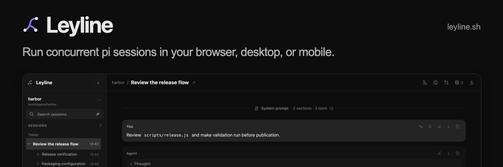
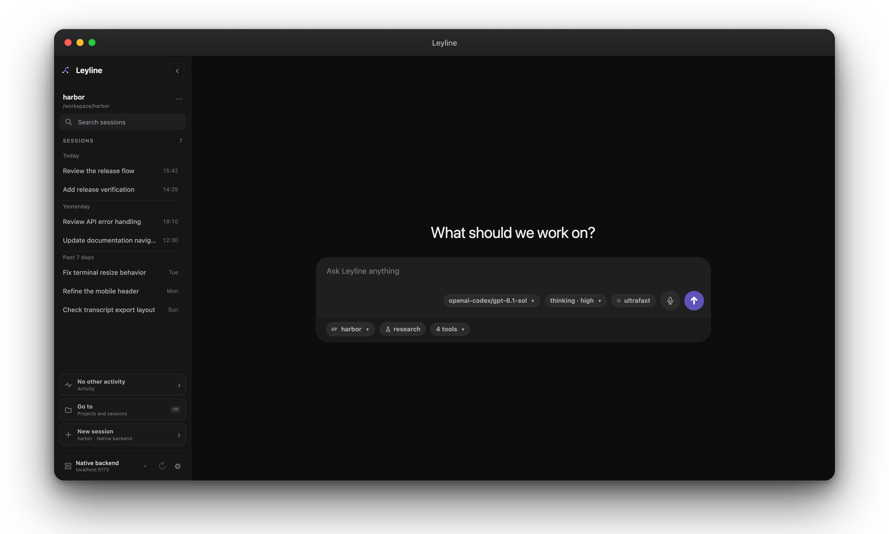
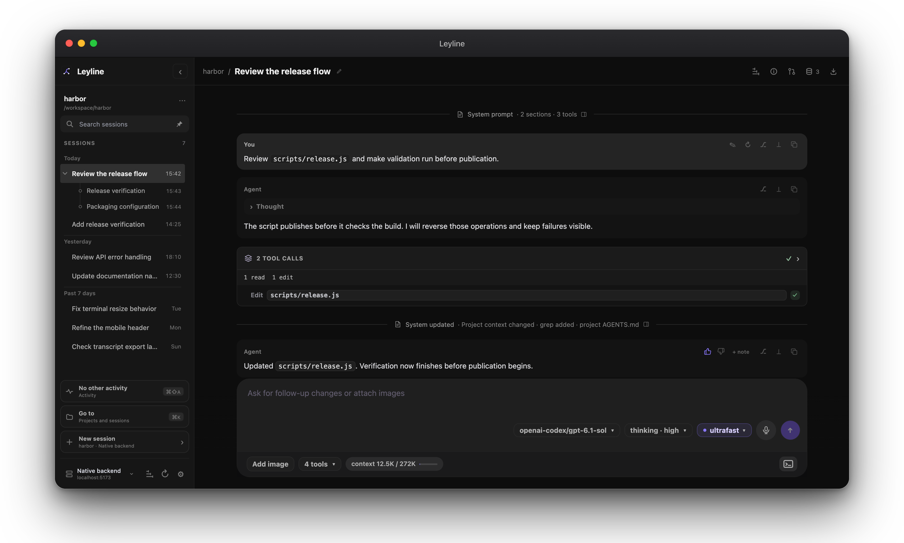
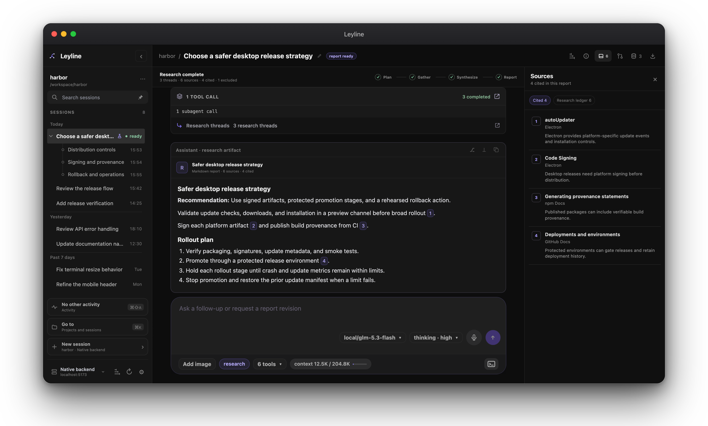
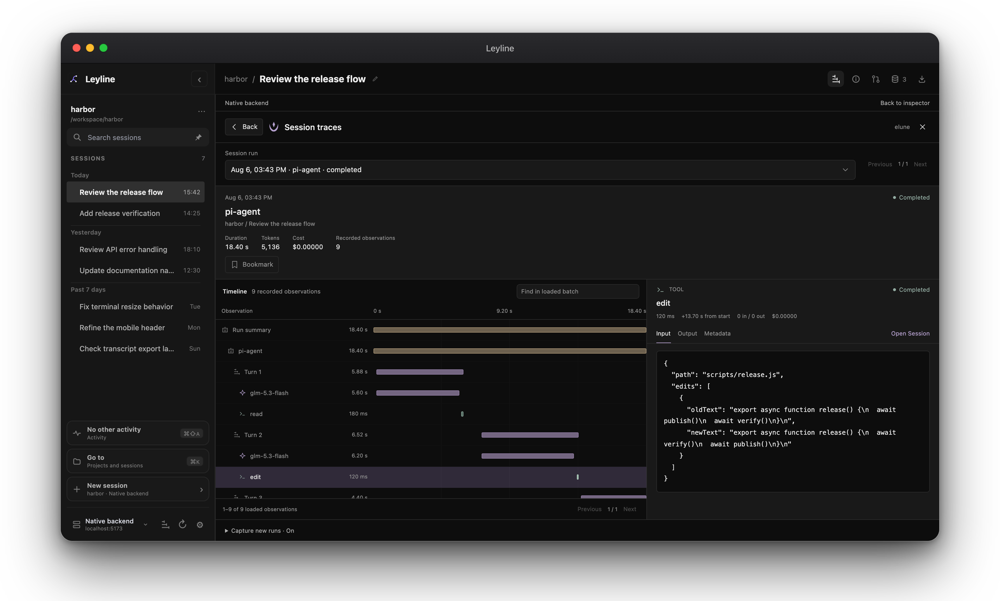
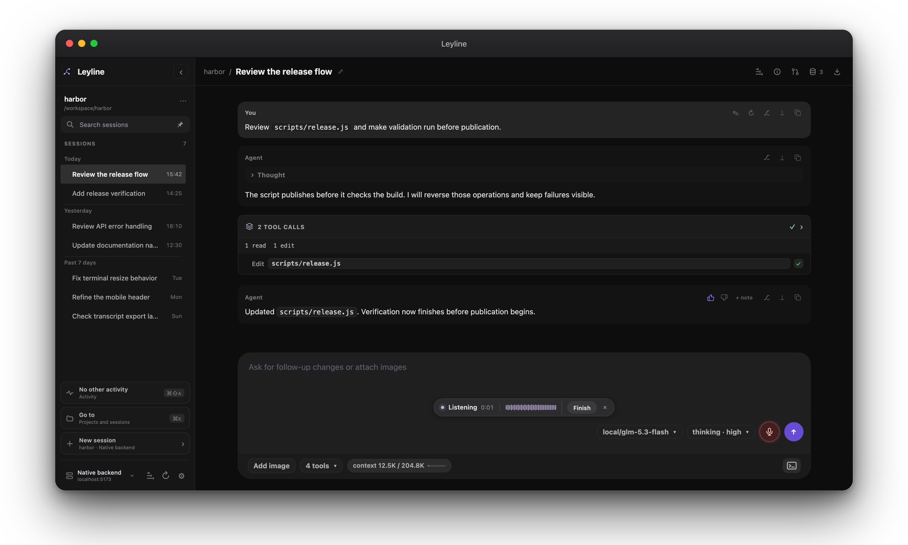

# [](https://leyline.sh/)

Leyline is a web UI for pi coding-agent sessions. It uses Vue 3 and Vite for
the frontend. Its native backend uses the pi SDK for sessions, prompts, model
controls, runtime events, and the embedded terminal. You can also save named
connections to other Leyline backends.

## Screenshots

<table>
  <tr>
    <td width="50%"><a href="assets/readme/home.png"></a><br /><strong>Start screen</strong></td>
    <td width="50%"><a href="assets/readme/workbench.png"></a><br /><strong>Workbench</strong></td>
  </tr>
  <tr>
    <td><a href="assets/readme/deep-research.png"></a><br /><strong>Deep research</strong></td>
    <td><a href="assets/readme/tracing.png"></a><br /><strong>Tracing workspace</strong></td>
  </tr>
</table>

See [Tracing](docs/user-guide/tracing.md) for recorded runs and capture controls.

## Documentation

- [Getting started](docs/getting-started/index.md)
- [Linux installation](docs/getting-started/linux-installation.md)
- [Sessions](docs/user-guide/sessions.md)
- [Composer](docs/user-guide/composer.md)
- [Runtime controls](docs/user-guide/runtime-controls.md)
- [Dictation](docs/user-guide/dictation.md)
- [Deep research](docs/user-guide/deep-research.md)
- [Git review](docs/user-guide/git-review.md)
- [Images and vision](docs/user-guide/images-and-previews.md)
- [Memory](docs/user-guide/memory.md)
- [Subagents](docs/user-guide/subagents.md)
- [Settings, providers, and MCP](docs/user-guide/settings.md)
- [Tracing](docs/user-guide/tracing.md)
- [Elune integration](docs/integrations/elune.md)
- [Terminal](docs/user-guide/terminal.md)
- [Electron](docs/electron/index.md)
- [Commands](docs/reference/commands.md)
- [Troubleshooting](docs/reference/troubleshooting.md)

## Features

- Browse, search, pin, and run pi sessions across projects. Show
  [only pinned sessions](docs/user-guide/sessions.md#show-only-pinned-sessions)
  in the sidebar. Read live transcripts and monitor work in **Activity**.
- Choose a model, thinking level, and [service tier](docs/user-guide/runtime-controls.md#choose-a-service-tier):
  Standard, Fast, or Ultrafast where supported. Standard remains the default.
- Steer active work or queue **Up next** tasks. Examine tools, System
  changes, local files, and Git changes. Use configured MCP tools and
  respond to extension requests in the workspace.
- [Read subagent activity](docs/user-guide/subagents.md#read-a-subagent-card)
  in an action ledger without leaving the parent session. Open rows for full
  output and arguments, or open child sessions from the sidebar.
  Use memory, HTML export, an embedded terminal, and deep research
  with validated citations. A configured vision model can
  describe images for models that cannot receive images.
- Connect each window to the native backend or a saved backend
  connection. Configure provider sign-in, custom endpoints, model
  overrides, and MCP servers in [Model settings](docs/user-guide/settings.md#find-a-configuration-in-the-catalog).
  Add [certificate authorities](docs/user-guide/settings.md#trust-certificate-authorities)
  for private HTTPS endpoints on the selected backend.
- Embedded Elune tracing records new runs by default. Examine one
  session or traces across projects on the selected backend. Traces can
  contain private prompts and tool results. See
  [Tracing](docs/user-guide/tracing.md).

## Dictation

In ordinary browsers, browser-managed dictation is the default; Electron uses local Parakeet or Whisper models. Local browser audio is processed on the Leyline-serving host, while Electron processes audio on-device. The responsive waveform appears only during local capture; see the [Dictation guide](docs/user-guide/dictation.md) for setup and controls.

<a href="assets/readme/dictation.png"></a>

*Local dictation in the composer. See the [Dictation guide](docs/user-guide/dictation.md) for setup and controls.*

Read [Motivations](docs/motivations.md) for the project direction.

## Desktop downloads

Download the Apple silicon macOS DMG or Linux x64 archive from
[GitHub Releases](https://github.com/spmurrayzzz/leyline/releases).

macOS builds use ad-hoc signing and are **not notarized by Apple**. macOS can
block the first launch. Follow the [macOS installation and security approval
steps](docs/getting-started/installation.md#macos-desktop-release), including
the app-specific quarantine fallback if necessary.

## Requirements

The Node.js, npm, and dependency-installation requirements below apply to
source builds. The downloaded desktop app includes its backend and runtime.

- macOS or Linux (see the tested setup below)
- Node.js 22.19.0, as specified in `.nvmrc`
- npm and Git, with GitHub access during dependency installation
- A configured pi coding-agent environment

Leyline operates on macOS and Linux. The Linux reference setup is x86-64
Omarchy (Arch-based). The setup runs Hyprland on Wayland. Leyline did not
validate other Linux distributions or architectures. Do not use Leyline on
Windows.

For a Linux desktop app and CLI that installs for one user, follow the
[Linux installation guide](docs/getting-started/linux-installation.md).

## Setup

```sh
npm install
```

This installs `@elune/embedded` from GitHub through the `spmurrayzzz/elune`
dependency. A sibling Elune checkout, an npm publication, and a standalone Go
server are not necessary.

## Development

```sh
npm run dev
```

Open the Vite URL that the terminal shows. The usual URL is:

```txt
http://localhost:5173/
```

The Vite server also serves the documentation at
`http://localhost:5173/docs/`. To run only the documentation server, use
`npm run docs:dev`.

## Multi-Backend Support

The device you use to view Leyline does not have to run the pi session
you are working on. A backend connection lets this window start agents,
read transcripts, and send prompts on another computer. That computer
provides the project files, terminal, tools, and pi configuration.
Agents can keep working on a desktop or server while you check them from
a laptop or phone, without copying the project or pi configuration.

The Native backend comes with this copy of Leyline. Add connections to
other Leyline backends in **Settings → Connections**. You can choose a
different backend for each window, so sessions on two computers can stay
open side by side. Each window shows the projects, session history, and
traces from its active backend. The sidebar footer names that backend.

Network access lets other devices open the Native backend. Leyline does
not require a password for network access, so enable it only on trusted
networks. See the [Settings guide](docs/user-guide/settings.md) to add
connections or
[share the Native backend](docs/user-guide/settings.md#share-the-native-backend).
The app and backend must use API v2, and live updates need WebSocket
connections.
See [Realtime events](docs/developer-guide/realtime-events.md).

## Optional Electron app

The browser and Vite workflow is the primary development path. Leyline can also
run as a local Electron desktop app.

For Electron development, start Vite in one terminal:

```sh
npm run dev
```

Then launch Electron in another terminal:

```sh
npm run electron:dev
```

Run this command to build a packaged desktop app:

```sh
npm run electron:build
```

The build writes the packaged app to `release/`. The build creates the Vite
`dist/` output and then packages Electron. The build unpacks the native
terminal files that `node-pty` needs and the embedded Elune library and SQLite
worker. The packaged backend runs in an Electron utility process. Rebuild and
restart the packaged app after dependency or backend updates.

On Linux, follow the [Linux installation guide](docs/getting-started/linux-installation.md)
to install `release/Leyline-linux-x64/`, a launcher, and an application-menu entry.
The repository's `bin/leyline` and `local-publish` script are still macOS-only.

On Apple silicon macOS, run this command to install the packaged app and
expose `leyline`:

```sh
npm run local-publish
```

This command puts `Leyline.app` in `/Applications/`. The command also links the
CLI to `~/.local/bin/leyline`. Make sure that `~/.local/bin` is on your `PATH`.

```sh
cd /path/to/project
leyline
```

The CLI opens or focuses Leyline and creates a session for the current shell
directory. Use `leyline -n` to open a new window at the home workspace. The
command does not create a session.

## Electron shortcuts (macOS)

- `Command+N`: create a session in the current session CWD
- `Command+Shift+N`: open Home in a new window. This does not create a session
- `Command+W`: close the current window
- `Command+E`: show or hide the sidebar
- `Command+,`: open global Settings
- `Command+Shift+E`: show or hide Session details
- `Command+Shift+M`: show or hide Memory
- `Command+Shift+T`: show or hide the terminal
- `Escape`: close open surfaces first. Preserve active dictation and dismiss
  dictation errors before stopping the active run

When focus is in the terminal, Escape stays in the shell unless another surface
is open.

## Useful commands

```sh
npm run build
npm run preview
npm run docs:dev
npm run docs:build
npm run docs:screenshots
npm run electron:dev
npm run electron:build
npm run local-publish # Apple silicon macOS only
npm run screenshot
npm run video
```

The capture commands require the Vite development server. `npm run screenshot` writes a
live local capture to `screenshots/current.png`. `npm run docs:screenshots`
refreshes sanitized tracked images with intercepted fixture data.
