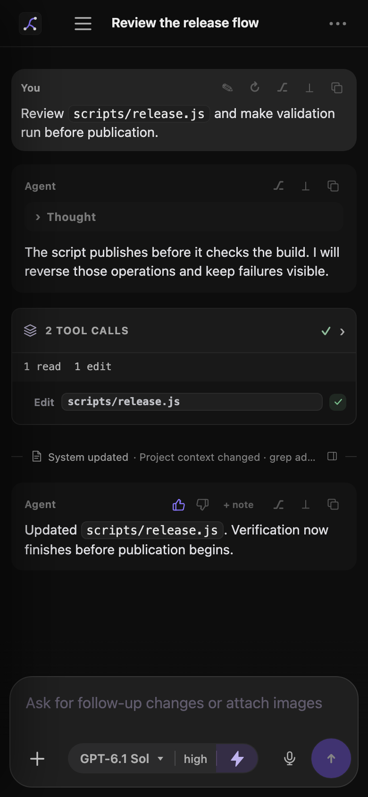
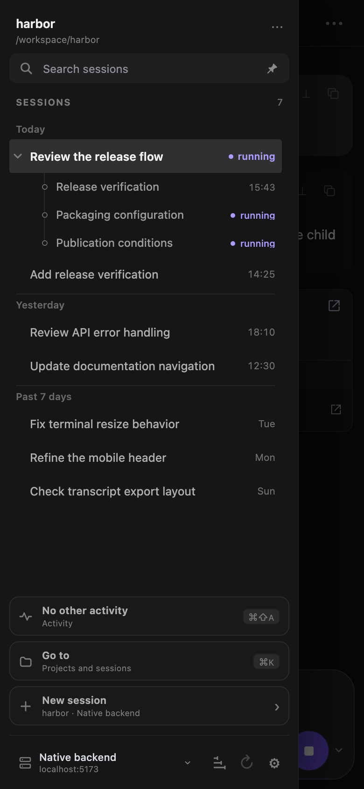
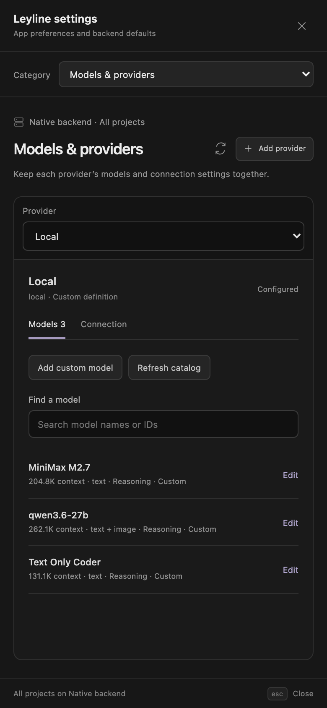
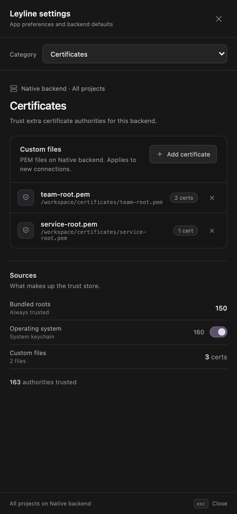
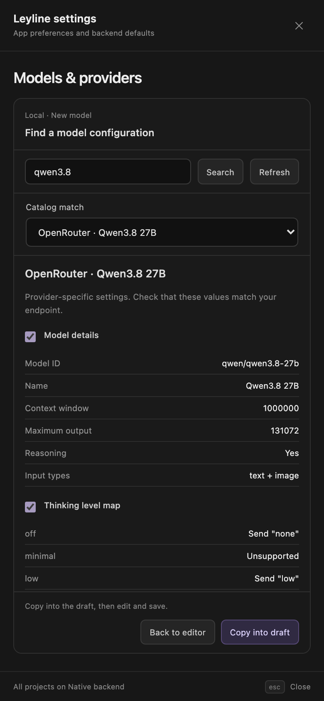
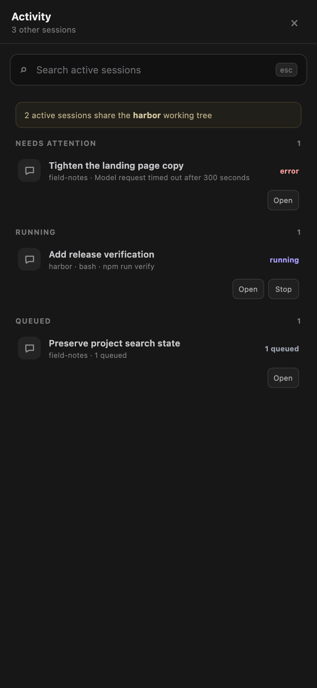
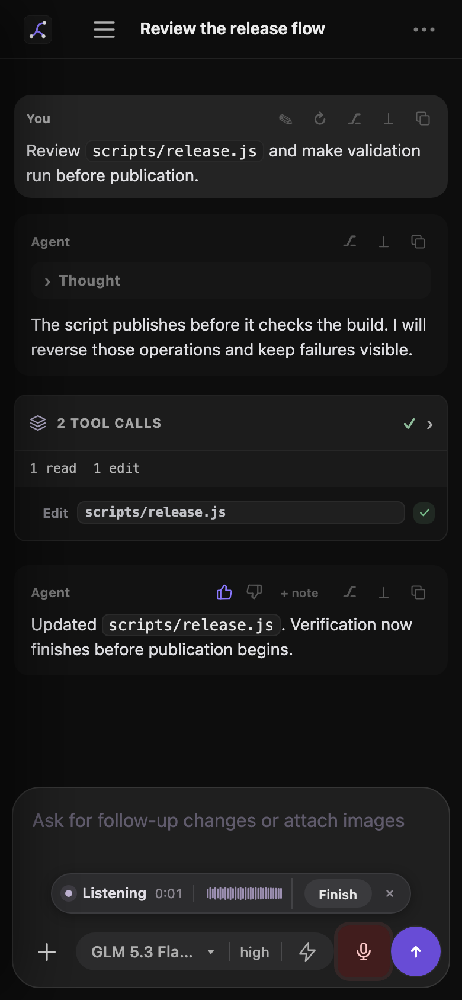
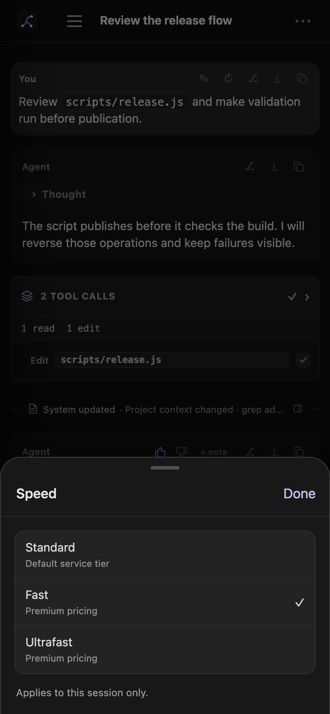
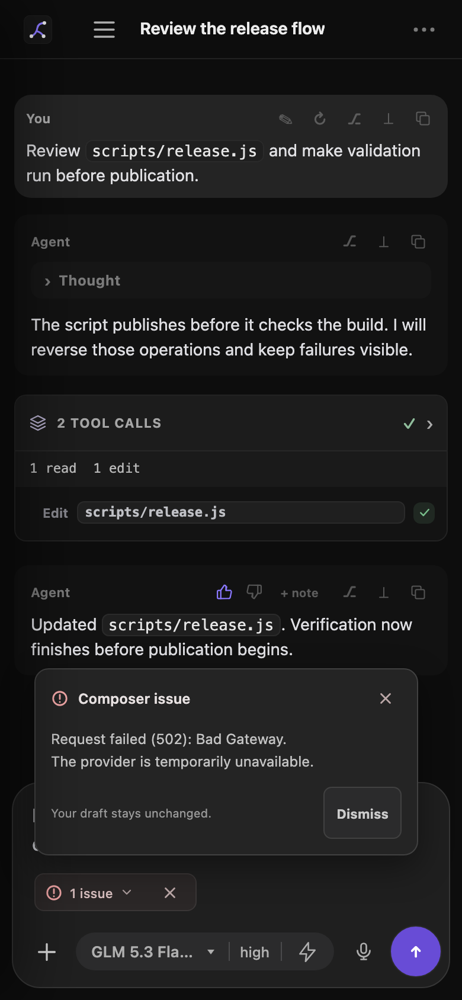

# Mobile layout

Leyline uses a mobile layout when the viewport is 760 pixels wide or less.

*The mobile composer uses one action row with a three-part settings capsule.*

## Use the mobile header

Select the Leyline mark to return to Home. Use **Open sessions** to open the sidebar. Select a session title to rename it.

Use **Session actions** (three dots) for traces, session details, Git review, memory, and export. Available controls depend on the session and backend.

On Home, the three-dot button opens **Session details**, which lists the enabled tools.

The project breadcrumb, rename glyph, and numeric action counts are hidden. Research sessions retain their compact state label.

## Open the mobile sidebar

*The session navigator opens above the mobile workbench.*

1. Select **Open sessions** in the header.
2. Select a session in the current project.

Subagent children appear as nested rows under their parent. Use the parent's left chevron to show or hide them. Select a child row to open its transcript. See [Sessions](./sessions#open-a-subagent-session) for expansion and search behavior.

Use the pin button beside search to [show only pinned sessions](./sessions#show-only-pinned-sessions). Select it again to restore all sessions.

Select **Go to** to open a session from another project.

The sidebar opens over the workbench. Select the shaded area or a session to close it.

The sidebar can use up to 86 percent of the viewport width, with a maximum width of 320 pixels. **Activity**, **Go to**, and **Add project** use the full viewport. **Add project** keeps its confirmation actions at the bottom.

## Open Settings on mobile

1. Select **Open sessions**.
2. Select **Open settings** at the bottom of the sidebar.
3. Use **Category** to select the settings page.

Settings fills the mobile viewport. **Models & providers** and **MCP servers** use a **Provider** or **Server** selector instead of the desktop list. Detail content scrolls within the modal.

Use **Close Leyline settings** to return to the workspace. See [Settings](./settings) for scope, authentication, and reload behavior.

### Manage certificates

Select **Certificates** in **Category**. **Custom files** appears above **Sources**. Select **Add certificate** to enter a PEM path on the selected backend, then select **Add file**. Repeat for each file, then select **Save**.

See [Trust certificate authorities](./settings#trust-certificate-authorities) for file limits and which connections use these settings.

### Set automatic session titles

Select **Agent defaults** in **Category**, then find **Session titles**. Choose a **Title model** and set **Thinking mode** if needed. Turn on **Automatic titles**.

See [Set automatic session titles](./settings#set-automatic-session-titles) for defaults, backend scope, and request charges.

### Share the backend with another device

Select **Connections** in **Category**, then turn on **Allow network access**. Copy an address that the other device can reach.

For a fixed port, enter **Proxy port** and select **Apply**. Leave the field blank for automatic selection. The port stays saved across restarts, and **Apply** does not change the sharing switch.

Changing the active port or turning access off disconnects remote clients and their terminals. Local clients and running agents continue. Use trusted networks only because the API has no authentication. See [Network access](./settings#share-the-native-backend) for scope and connection details.

### Edit a model or copy catalog fields

The model editor temporarily hides the category and provider selectors. **Model**, **Thinking & compatibility**, and **Pricing** share one draft. Save/Test stay visible below the fields.

**Find in catalog** replaces the fields with search and review. Use **Catalog match** to choose a provider variant. Search and the Back/Copy controls stay visible while the review scrolls.

Copying **Model details** opens **Model**, where you can edit a new model's imported ID. **Back to editor** keeps your draft. See [Catalog lookup](./settings#find-a-configuration-in-the-catalog) for copied fields and exclusions.

## Set a session batch size

1. Open **Session actions** in the session header.
2. Select **Session details**.
3. Find **Subagents**.
4. Change **Batch size**.
5. Leave the field to save the value.

Select **Use global default** to remove the session override. The global default is in **Settings → Agent defaults → Subagents**. There is no project batch-size override.

Batch size limits work within each batch, not total concurrent work across the session. See [Configure batch size](./subagents#configure-batch-size) for values, scope, and when changes apply.

## Supervise activity on mobile

*Activity keeps long session details bounded and moves row controls below the status on narrow screens.*

1. Select **Open sessions**.
2. Select **Activity**.
3. Select **Open** or **Stop** for a session.

The mobile view uses the same attention, running, queued, held, and shared-working-tree states as the desktop view. Open a session to resume its held queue or reply to a confirmation.

## Use transcript actions

Message and tool actions remain in their row headers. Use them to copy, edit, retry, fork, reset, or open tool output.

Tool targets can shorten to fit the row. User messages and tool cards use the full transcript width.

## Inspect subagent tasks

Subagent calls open a bottom sheet instead of expanding the transcript. If an Activity card contains only one subagent call, select its header or row to open the sheet directly. Parallel tasks still count as one call.

Select a task to see its action ledger, then select a row to read the full entry. **Full task prompt** opens the instructions. **Back to activity** restores your place in the ledger.

**Full task prompt** is a full-width header action below the title and icons. The Model and Thinking chips stay in the meta row. Model text can shorten to fit the available width.

Task details and the latest response use bounded scroll sections to keep space for **Activity**. Reader sections scroll below **Back to activity**, which stays visible. **Copy full text** copies the open entry, and **Open child session** opens the complete transcript.

The current reader stays visible until the next task preview is ready. The task highlight, reader, and footer then change together without moving the sheet. Reduced motion removes the animation.

A running child updates the ledger with messages and tool activity. Select a running call for its current output and arguments. Scroll up to pause following. Select **New output** or **Jump to latest** to return to the latest activity.

Closing the sheet leaves the child run active. See [Follow an active child](./subagents#follow-an-active-child) for preview limits and reconnect behavior.

Select the close button or backdrop to return to the transcript. See [Subagents](./subagents#read-a-subagent-card) for outcome labels and confirmation behavior.

## Use the mobile composer

The composer stays above the bottom edge. Its action row contains **Add to message**, the settings capsule, dictation, and Send. During dictation, a compact waveform and gray **Finish** chip appear above the composer.

Browser dictation is the default in normal web browsers. It is browser-managed and may use an online service. Select **Local models** in Settings to use Parakeet or Whisper Turbo. In a browser, local-model speech runs on the Leyline server that serves the app. In Electron, local-model speech runs on this device. Dictation requires a secure context: use HTTPS or localhost, not ordinary LAN HTTP. See [Dictation](./dictation) for setup and processing details.

The gray capsule has three separate controls. Select the model name to open **Session options**. Select the thinking level to open **Thinking**, or the lightning bolt to open **Speed**.

**Speed** lists **Standard** and each eligible premium tier: **Fast**, **Ultrafast**, or both.

*Fast is selected for `gpt-6.1-sol` in the mobile Speed sheet.*

The bolt stays visible for all models. It is gray and outlined for **Standard**, or lavender and filled for **Fast** or **Ultrafast**. For unsupported models, **Speed** explains that Fast and Ultrafast are unavailable.

Tier changes remain available during generation or compaction. An in-flight request keeps its tier. Model eligibility, account restrictions, pricing, and session scope match desktop. See [Choose a service tier](./runtime-controls#choose-a-service-tier).

During an active run, an empty draft shows **Stop**. Add text or an image to restore the send arrow and queue the draft in **Up next**. Select **Send options** beside the arrow for **Queue next task** or **Steer current run**.

Select the attached **Up next** tab to open the tray across the composer width. The tab moves above the list. The input and footer stay fixed while the list scrolls. Each task has one actions menu for edits, order changes, steering, and removal.

**Stop** holds remaining unsent tasks. The closed **Held** tab shows the count and **Resume**. Text edits keep images, and closing the tray keeps an unsaved edit. Save or cancel the edit before you select **Resume**. See [Composer](./composer#queue-the-next-task) for queue details.

Use **Add to message** for images, a new line, or research mode when available.

Open **Session details** through **Session actions** for enabled tools, context usage, and terminal access.

### Read composer issues

The **1 issue** chip appears in a separate row above the mobile controls. Select it to read the full error, then select **Dismiss**. You can also select **×** on the chip.

Dismissing the notice keeps your draft and attachments. If Send remains blocked, select **Details** beside **Send unavailable**. See [Composer issues](./composer#read-and-dismiss-an-issue).

## Open research sources

A [deep research](./deep-research) source pane opens across the full viewport. It has **Cited** and **Research ledger** views.

Select **Session actions**, then **Research sources**, to open the pane. Select **×** to close the pane and return to the report.

Select a report citation to open its source preview as a bottom sheet.

## Inspect traces on mobile

Select **Session actions**, then **Session traces**, for the current session. For all projects on the selected backend, open the sidebar and select the **Trace explorer** icon button.

*Trace views fill the width below the header.*

Use **Observations** or **Timeline** and **Selected detail** to switch panels. The explorer uses **Traces** and **Selected preview**. Expand **Capture new runs** in the footer to change capture for future runs.

**Back** returns from the workspace to its inspector or explorer. Opening the sidebar or terminal closes traces. See [Tracing](./tracing) for batch limits and privacy.

## Use drawers and the terminal

Right-side drawers can use the full viewport width, with a maximum width of 420 pixels.

The terminal opens from the bottom. Its default height is 310 pixels.

The transcript adds space for the composer and terminal, so the newest output remains reachable.
