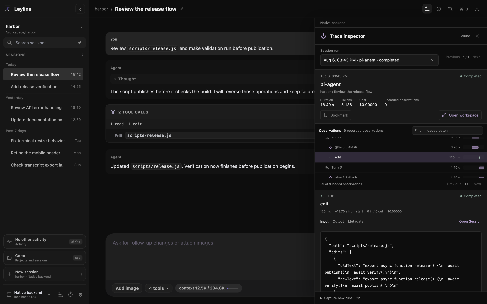
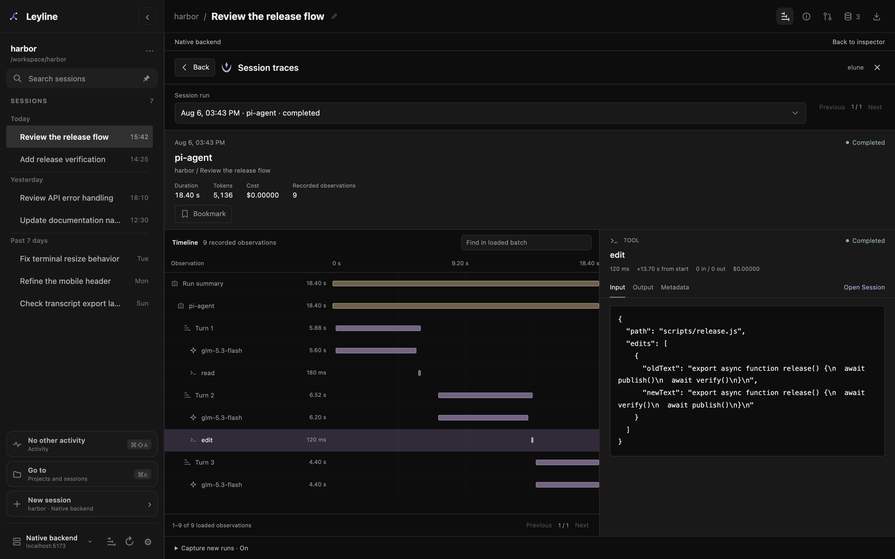
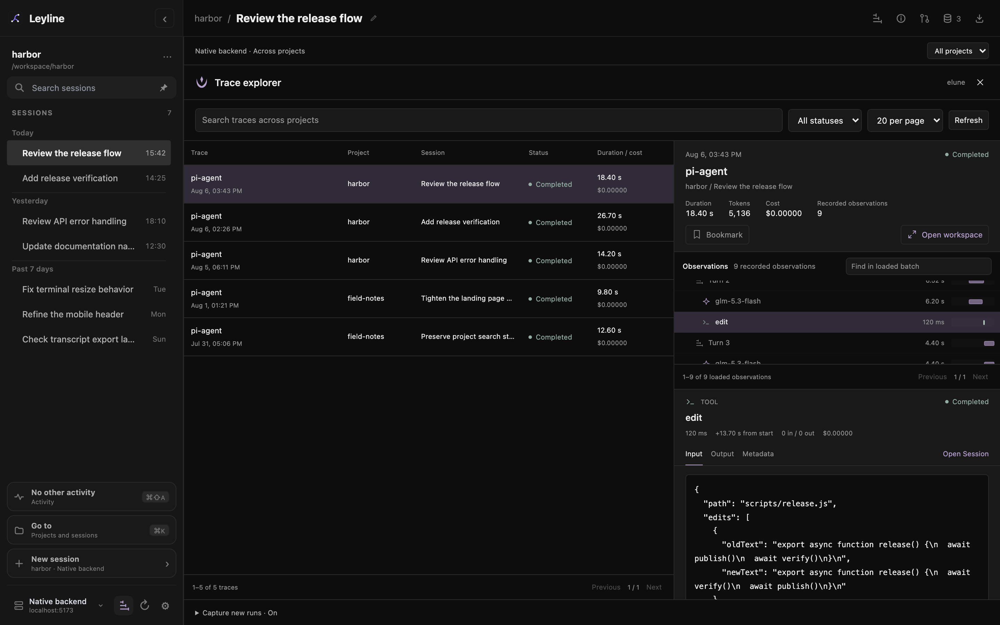
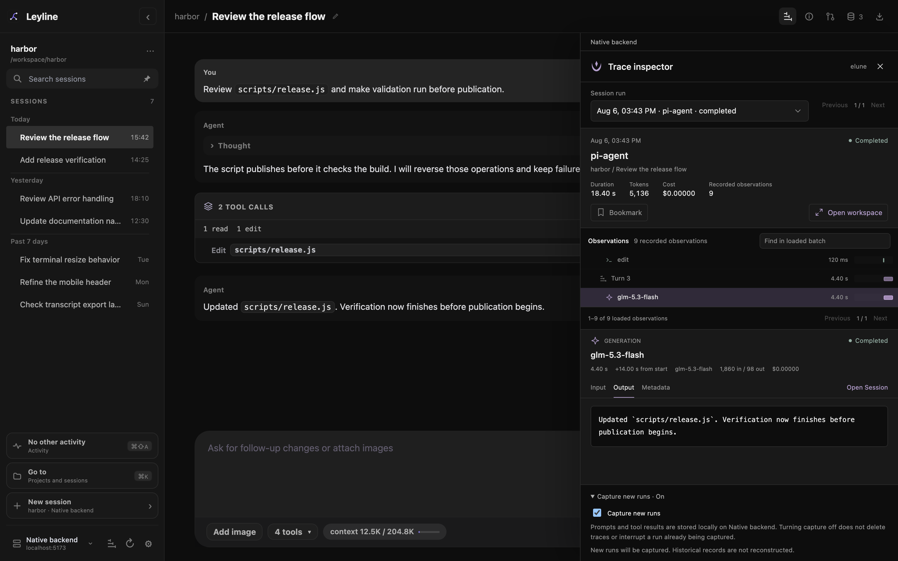

# Tracing

Leyline includes Elune to record new agent runs on the selected backend. A trace keeps model calls, tool activity, timing, usage, and available input and output after the run ends.

Capture starts **On** for new runs. Earlier pi session logs are not backfilled. You do not need the standalone Elune Go server or `PI_TRACE_URL`.

## Inspect a session run

1. Open a session.
2. Select **Session traces** in the workbench header.
3. Use the **Session run** dropdown to select a recorded run.
4. Select an observation to inspect its details.

*The inspector opens over the right side of the transcript.*

The summary shows duration, tokens, cost, status, and the recorded observation count. An observation is one recorded operation, such as a model call or tool call.

Use **Input**, **Output**, and **Metadata** to read the selected operation. Select **Run summary** to inspect the trace itself. Available usage depends on what the model provider reports.

Select **Bookmark** to mark a trace. Select **Bookmarked** to remove the mark. Bookmarks persist on that backend.

**Open session** closes the trace view and opens the related transcript. When an entry link is available, Leyline scrolls to that entry. An entry can be unavailable after a branch change or reset.

Tool observations can show **Child sessions** links for delegated work, including subagents, research workers, and vision children. These links open the child transcript.

Captured manual compaction can appear as a separate `pi-compaction` run. Automatic compaction can appear within an active run. Compaction records show the available summary, outcome, and usage.

## Open the tracing workspace

Select **Open workspace** from the inspector or explorer.

*The workspace uses the area after the sidebar for the timeline and details.*

The workspace keeps the selected trace, observation, content tab, and loaded observation batch. It does not select a different conversation session.

Select **Back** to return to the inspector or explorer that opened it. The current selection returns with you. Explorer filters and its results page remain in place.

Press **Escape** or select **Close traces** in the workspace to return to that same origin. In the inspector or explorer, either action closes traces. Closing traces does not stop capture or the agent run.

Opening Settings, another workbench drawer, or the terminal closes the trace view. Navigation to another session or backend also closes it and clears trace selection. Closing a view alone leaves the selected conversation session unchanged.

## Browse traces across projects

Select the **Trace explorer** icon button at the bottom of the sidebar. Its tooltip and accessible label are **Trace explorer**. You can open it from Home without a selected session.

*The explorer lists traces across projects on the selected backend.*

Use these controls to narrow the results:

- **Trace project** selects one project or **All projects**.
- **Search traces** matches recorded trace fields, including names, session details, and available input and output. It is not a complete search of every observation payload.
- **Trace status** selects **Completed**, **Running**, **Error**, or **Aborted**.
- **Traces per page** selects 10, 20, or 50 results.

Select a row to inspect its preview. Select **Open workspace** for the timeline. Use **Refresh** if results appear stale.

The backend name appears above the view. The explorer never combines records from different backend connections. Switching connections opens that backend's separate trace collection and capture setting.

## Control capture

1. Open the inspector, workspace, or explorer.
2. Expand **Capture new runs** in the footer.
3. Select or clear the **Capture new runs** checkbox.

*Capture controls belong to the trace panel, not a global Settings category.*

The setting applies to future runs on that backend, across its projects. A run already under capture finishes its capture. Turning capture off does not delete older traces.

Capture continues when trace views are closed. Reopen a trace view to check its current setting. If you close the view during a pending change, reopen it to confirm the saved result.

A capture failure appears in the footer. Agent work can continue even when tracing fails. See [Troubleshooting](../reference/troubleshooting#trace-capture-fails-or-a-change-is-unconfirmed).

## Read partial records

Large traces load observations in batches. **Previous batch** and **Next batch** change the loaded batch. The loaded range and recorded total appear below the observations.

**Find in loaded batch** searches only the loaded observation names, types, models, and statuses. It does not search all batches or their input and output. Load another batch to search it.

The **Input** and **Output** tabs show retained content, not complete raw provider requests or responses. Capture omits image payloads and thinking content.

The view reports omitted or truncated content when the stored record includes the corresponding markers. That missing content is not available in the stored trace. A separate **Fields clipped on read** notice means the stored content remains unchanged.

Long displayed payloads use character pages. An incomplete observation count has a notice only when the trace producer flags it.

Storage or capture failures can leave partial traces without a stored warning. A temporary backend error can disappear after restart. The absence of a warning does not prove that a trace is complete.

Status and metadata levels provide basic attention flags. They do not provide an evaluation dashboard or prove the quality of an agent's result.

## Use traces on mobile

*Trace views fill the width below the mobile header.*

Use **Observations** or **Timeline** and **Selected detail** to switch panels. In the explorer, use **Traces** and **Selected preview**. The same run, capture, and privacy rules apply.

## Keep trace data private

Traces stay on the selected backend. For a remote connection, local storage means that backend's computer, not the browser's computer.

Traces can contain raw prompts, tool arguments, tool results, file content, and private project metadata. Leyline does not provide trace encryption or guaranteed secret redaction. Treat the trace database and backend access as private.

Deleting a session or trashing a project does not delete its traces. **Reset to here** changes the session file but does not remove earlier trace data. Trace links can therefore point to missing sessions or entries.

Leyline has no automatic retention limit or expiry. It has no trace deletion or export control, and no trace deletion or export API. [HTML transcript export](./export) does not include Elune traces. Turning capture off prevents future capture only.

For storage, capture internals, and backend routes, see [Elune integration](../integrations/elune).
